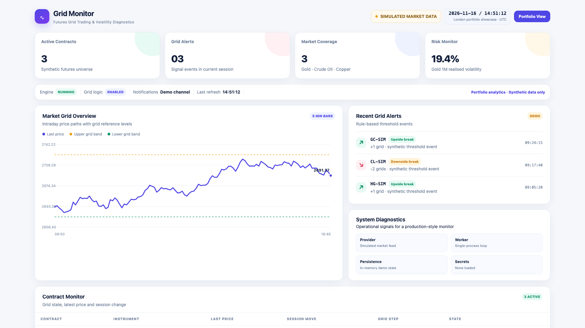
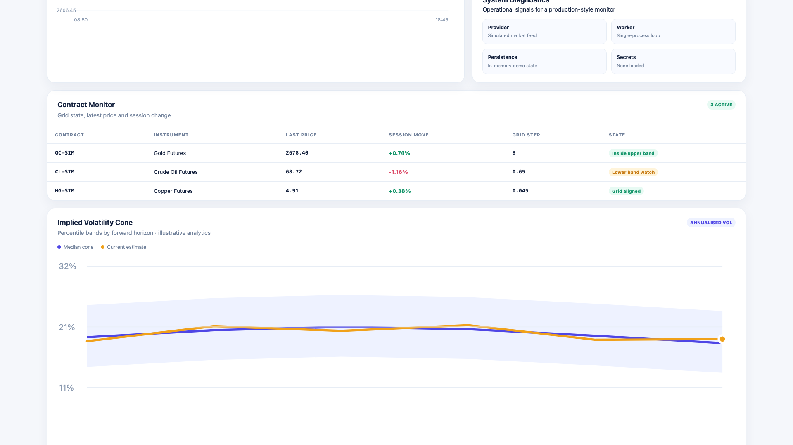

# Futures Grid Monitor & Volatility Diagnostics

A public, offline-safe showcase of a Flask-based futures monitoring platform. The system combines real-time market-data diagnostics, dynamic grid rebase logic, and event-driven risk alerts. This repository is intentionally sanitized for portfolio and interview use: the default configuration is `manual_only` market data plus `dry_run` notifications, and the screenshots use synthetic instruments such as `GC-SIM`, `CL-SIM`, and `HG-SIM`.

## Key Quantitative & Engineering Features

- **Volatility cones** for comparing realised volatility across rolling horizons and percentile bands.
- **Implied-volatility surface and skew diagnostics** as an extensible analytics layer for derivatives research workflows.
- **Dynamic Grid Rebase**: the grid reference price can be updated when configured market conditions are met, while preserving alert deduplication and burst protection.
- **Market-provider abstraction** with an optional iFind adapter, batch quotation support, resolved contract-code mapping, and safe failure isolation.
- **Event-driven alerting** with AlertLog history, delivery status tracking, retry scheduling, and a Feishu adapter that is disabled in the public demo defaults.
- **Operational diagnostics**: preflight checks, per-contract polling status, health reporting, and a compact monitoring dashboard.

## Architecture & Technology

- Python and Flask/Jinja for the web application
- SQLAlchemy with SQLite for local persistence
- Requests for provider and notification adapters
- Gunicorn and Caddy examples for a single-process web + worker deployment
- pytest for unit, route, integration-safety, and boundary-condition tests

The public copy contains no production database or credentials. Optional live integrations are configuration-driven and should only be enabled with private secrets outside this repository.

## Project Structure

```text
.
├── app/
│   ├── market/          # provider abstraction, iFind adapter, contract mapping
│   ├── monitor/         # monitoring engine, scheduler, grid decisions
│   ├── notify/          # notification adapters and delivery state machine
│   ├── routes/          # dashboard, auth, health and operational routes
│   ├── static/          # dashboard CSS and JavaScript
│   └── templates/       # Flask/Jinja templates
├── demo_showcase/       # synthetic-data visual showcase and screenshots
├── deploy/              # systemd and reverse-proxy examples
├── docs/                # deployment and local runbooks
├── scripts/             # safety checks and operational helpers
├── tests/               # automated test suite
├── main.py
├── gunicorn.conf.py
├── requirements.txt
└── .env.example
```

## Quick Start (Offline / Simulation Mode)

```bash
cp .env.example .env
python -m venv .venv
source .venv/bin/activate
pip install -r requirements.txt
MARKET_DATA_MODE=manual_only NOTIFICATION_MODE=dry_run flask --app main run --port 5001
```

Open `http://127.0.0.1:5001`. Keep `.env` local and replace placeholder values only in your private environment. The public showcase can be regenerated without any external API call:

```bash
python demo_showcase/generate_demo_data.py
```

The generated portfolio visuals use synthetic prices and volatility data only.

## Screenshots






## Testing & Reliability

Run the suite in offline-safe mode:

```bash
MARKET_DATA_MODE=manual_only NOTIFICATION_MODE=dry_run pytest -q
```

The tests cover authentication, dashboard routes, contract-code resolution, polling failure isolation, dynamic grid behaviour, alert history, notification delivery state transitions, and deployment safety checks. Tests use mocks and isolated databases; they do not require live iFind access or send external notifications.

## Configuration & Safety

The public template lists the supported environment-variable keys with placeholders. Never commit `.env`, a database file, logs, tokens, webhook URLs, passwords, or signing secrets. For production-style deployment, keep Gunicorn at `workers=1` while the first-generation web and worker processes are combined; see `docs/DEPLOYMENT.md`.

This repository is a portfolio-ready public copy, not a live trading service. Validate all exchange conventions, market-data permissions, and risk controls independently before any private deployment.
